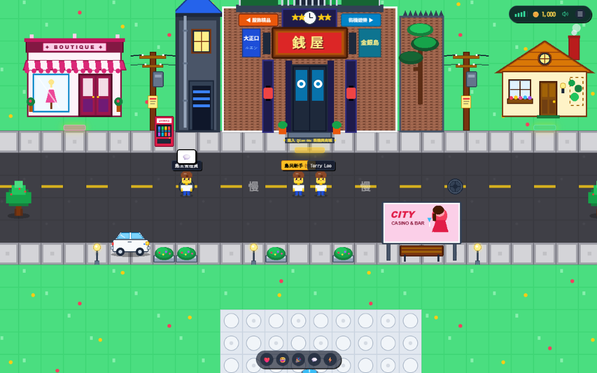

# 🏝️ Pixel Island (像素島) - 2D 多人即時線上遊戲島

一款基於 **React (Vite) + Tailwind CSS + Firebase + Cloudflare R2** 開發的 2D 像素風多人即時在線同島網頁遊戲。完美適配電腦端（WASD / 方向鍵）與手機/平板（虛擬十字鍵 D-Pad 與觸控），並支援多人在線走動、動態商城穿搭、小屋佈置與 8-Bit 街機對戰！

- 🌐 **正式遊戲網址**：[https://game.terry0215.com](https://game.terry0215.com)
- 🚀 **Vercel 預備網址**：[https://pixel-island-eight.vercel.app](https://pixel-island-eight.vercel.app)



---

## 🌟 核心特色 (Core Features)

### 1. 🎮 復古日系 2D 像素島嶼 (36x36 Square Island)
- **經典日系昭和街機建築「銭屋 (Qian-Wu)」**：精美繪製多層復古招牌、霓虹導引、電線桿、復古廣告看板、白色迷你小汽車、販賣機與街道「慢」字樣。
- **純粹像素渲染**：全站強制套用 `image-rendering: pixelated;`，絕不失真破圖。
- **極致流暢移動體驗**：130ms 線性無縫鏡頭平移追隨、零卡頓鍵盤與虛擬搖桿控制，搭配果凍彈跳紙娃娃行走動畫。
- **100% 防破圖 Fallback**：內建原生向量 Canvas/SVG 像素繪圖引擎 (`<PixelAsset />`)，素材未上傳前即可 100% 完整遊玩。

### 2. ⚡ 雙引擎混合資料庫設計 (Firebase RTDB + Cloud Firestore)
- **Firebase Realtime Database (RTDB)**：處理每秒多人即時座標同步、朝向、動態頭頂表情泡泡，支援 `onDisconnect().remove()` 斷線瞬除。
- **Cloud Firestore**：持久化儲存玩家金幣、背包資產、紙娃娃穿搭與 12x12 小屋家具佈局。

### 3. 🕹️「銭屋」街機遊樂場：四大多人連線對戰遊戲
1. **雙人互猜 1A2B**：即時雙方秘密數字對決，支援 4 碼不重複密碼推理與對戰紀錄。
2. **三子無限模式 OOXX (Tic-Tac-Toe Infinite)**：雙方場上最多保留 3 顆棋，下第 4 顆時最早棋子消散，打破平局死棋。
3. **海戰棋 (Battleship)**：8x8 迷霧海域，佈置戰艦與輪流砲擊，先擊沉敵方全艦隊者獲勝。
4. **點線棋 (Dots and Boxes)**：5x5 點陣連線佔地，封閉格子獲取額外回合。
- *支援：4 碼房號好友配對、公開大廳清單，以及隨時可賺取金幣的「單人挑戰 AI 模式」。*

### 4. 👗 精品服飾店 & 個人衣櫃 (Boutique & Wardrobe)
- 即時動態讀取商品資料庫，支援試穿預覽、金幣購買。
- 隨時開啟個人衣櫃切換髮型、上衣、下著與配件，同島玩家即時看到最新換裝。

### 5. 🏡 溫馨小屋佈置 (Home Decorator)
- 進入 12x12 個人專屬室內房間，開啟「🔨 佈置模式」點擊地面自由擺放、旋轉家具。
- 支援島上直接拜訪好友房間，一同串門子聊天。

### 6. 🛠️ 管理員動態後台 (Admin Dashboard)
- 支援動態新增、編輯、下架服飾與家具商品。
- 整合 Cloudflare R2 圖片上傳與 64x64 紙娃娃實時對齊預覽框。

---

## 🚀 快速開始 (Getting Started)

### 1. 安裝相依套件
```bash
git clone https://github.com/terry5333/pixel-island.git
cd pixel-island
pnpm install # 或 npm install
```

### 2. 設定環境變數
複製 `.env.example` 為 `.env` 並填入 Firebase 與 Cloudflare R2 憑證：
```bash
cp .env.example .env
```

```env
VITE_FIREBASE_API_KEY=your_api_key
VITE_FIREBASE_AUTH_DOMAIN=your_project.firebaseapp.com
VITE_FIREBASE_DATABASE_URL=https://your_project-default-rtdb.asia-southeast1.firebasedatabase.app
VITE_FIREBASE_PROJECT_ID=your_project_id
VITE_FIREBASE_STORAGE_BUCKET=your_project.firebasestorage.app
VITE_FIREBASE_MESSAGING_SENDER_ID=your_sender_id
VITE_FIREBASE_APP_ID=your_app_id
VITE_R2_PUBLIC_URL=https://your_account.r2.cloudflarestorage.com/rpg
```
*(提示：若尚未填入 Firebase Key，遊戲會自動啟用內建的高擬真 Local Mock Mode 離線模擬器，開箱即可立刻體驗！)*

### 3. 本地啟動開發伺服器
```bash
pnpm run dev
```
瀏覽器開啟 `http://localhost:5173` 即可開始冒險！

### 4. 編譯生產環境版本
```bash
pnpm run build
```

---

## 🛠️ 技術棧 (Tech Stack)
- **Frontend Framework**: React 19, TypeScript, Vite
- **Styling**: Tailwind CSS, Lucide React, Pixel UI System
- **Realtime & Backend**: Firebase (Auth, Cloud Firestore, Realtime Database)
- **Storage**: Cloudflare R2 (S3 Compatible API)
- **Audio Synthesizer**: Web Audio API Retro 8-Bit Chiptune SFX Engine
